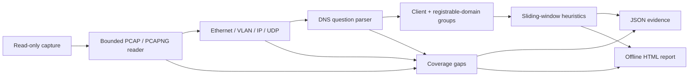

# Design and reasoning

The question is narrow: which client/domain groups show a burst of diverse,
encoded-looking DNS labels, and what observations support that signal?

## Why entropy alone is not a detector

Shannon entropy measures the observed distribution of characters in a label.
`aaaaaaaa` has zero entropy; an evenly distributed four-character alphabet has
two bits per character. A long session identifier may have a varied alphabet
without being malicious. Finite samples and the label's alphabet limit what an
entropy value means.

The workbench requires four concurrent conditions:

1. A subdomain label has at least the configured number of characters.
2. That same label meets the entropy threshold.
3. At least the configured number of distinct qualifying query names occur in a time window.
4. Qualifying queries make up a minimum fraction of that window's queries.

Labels in the registrable domain itself do not count. Each client has a separate
window. Allowlisting is explicit and visible. Even with all conditions met,
the result is a request for human review, not an attribution or malware verdict.

## Why domain grouping matters

Taking the last two labels fails for `co.uk` and merges unrelated `github.io`
tenants. The Public Suffix List's prevailing rule uses longest exact/wildcard
matches and exception rules. Including PRIVATE rules keeps tenant owners apart.
The bundled list's version/hash identifies the boundary rules used in a report.

## Why parser failures must be part of the result

A capture can contain valid DNS evidence before a truncated record. Discarding
the evidence hides useful observations; treating parsing failure as no alerts
hides missing coverage. The tool retains prior observations and marks coverage
limited. Exit code 2 takes precedence over any review signal.

Names have a 255-byte wire bound; compression traversal is capped and backwards
pointers are checked. Capture record lengths are bounded before allocation.
Packet, question and file-size limits make work finite. Those controls reduce
accidental resource exhaustion; they are not a formal security sandbox.

## Complexity and ownership

Capture decoding is streamed. The analysis retains at most the configured number
of query/response question records. Correlation and grouping sort observations
by time, taking O(n log n) time and O(n) retained space. Window queues and name
counters use incremental updates; candidate evidence samples are capped at eight.

`capture.py` owns format validation; `analysis.py` owns grouping and heuristics;
`report.py` owns escaped presentation; `demo.py` owns synthetic fixtures; the CLI
owns user-selected paths and exclusive output creation. No module calls a network
API or shells out during normal analysis.

## Deliberate first-version limits

TCP stream reconstruction and IP fragmentation introduce state and ambiguity
that deserve independent designs/tests. They are deferred instead of pretending
the current UDP question parser can cover them. Encrypted DNS cannot be inferred
from cleartext port-53 names that are not present in the input.

Future improvements need actual evidence: a labeled, licensed capture corpus;
different operating environments; false-positive review; TCP support with
retransmission/overlap semantics; and fuzzing beyond the current deterministic
random-byte smoke tests.
